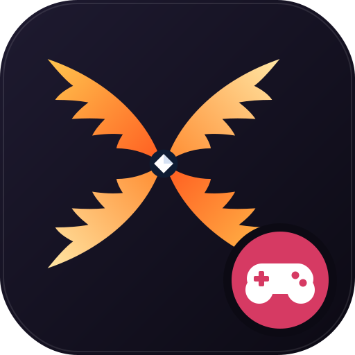

# Kanatix Arcade



Retro atari salonu derlemesi. Windows için tek `.exe`, Android için `.apk`.

İndir: **Releases** sayfasından `KanatixArcade.exe` (Windows) veya `KanatixArcade.apk` (Android).

## Oyunlar

| Oyun | Açıklama |
|------|----------|
| **Dövüş Arenası** | 4 dövüşçü (Daiki, Jax, Kaito, Titus), özel ve süper hareketler, kombolar, 3 arena (Ejder Kalesi, Neon Çatı, Gece Metrosu). 1P (bilgisayara karşı) veya 2P |
| **Neon Yılan** | Klasik yılan oyunu, altın elmalar |
| **Tuğla Kırıcı** | Seviyeler ve güçlendirmeler (geniş raket, çoklu top, ekstra can) |
| **Uzay İstilası** | Dalga dalga gelen uzaylılar, kalkanlar, bonus ana gemi |
| **Neon Pong** | Bilgisayara ya da arkadaşına karşı |

## Dövüş Arenası kontrolleri

| | 1. Oyuncu | 2. Oyuncu |
|--|--|--|
| Hareket | W A S D | Yön tuşları |
| Yumruk | F | K (veya Numpad 1) |
| Tekme | G | L (veya Numpad 2) |

Tek oyunculu modda iki tuş takımı da çalışır: **yön tuşları + K (yumruk) / L (tekme)** ya da **WASD + F / G**. Ekrandaki tuş göstergeleri gerçek klavye tuşlarını gösterir. Gamepad de desteklenir.

- **Blok:** Geri yöne bas. Alçak saldırılara karşı **↓ + geri** bas.
- **ESC:** Duraklatma menüsünü açar. Menüde tüm karakterlerin **hareket listesi** var.
- **TAB:** Dövüş sırasında ekrandaki özel hareket listesini açar/kapatır.

### Telefonda (APK)
Solda **yön çemberi**, sağda **YUMRUK** ve **TEKME** tuşları var. Her özel hareketin ve **SÜPER**'in kendi tuşu da var; tek dokunuşla çıkar (komut girmeye gerek yok). Süper barı dolunca SÜPER tuşu parlar. Ortadaki **II** tuşu oyunu duraklatır.
Bilgisayarda da dokunmatik ekran varsa **Ayarlar → Dokunmatik Kontroller → AÇIK** ile kullanılabilir.
- **F11:** Tam ekran.

### Özel hareketler (karakter sağa bakarken)

**DAİKİ (Dövüş Ustası):** Geleneksel dövüş ustası. Ki dalgası ve ejder yükselişiyle dengeli.
- Ki Dalgası: ↓ ↘ → + K (Yumruk)
- Ejder Yükselişi: → ↓ ↘ + K (Yumruk)
- Kasırga Tekmesi: ↓ ↙ ← + L (Tekme)
- **SÜPER: Ejder Fırtınası:** ↓ ↘ → ↓ ↘ → + K (Yumruk)

**JAX (Sokak Kurdu):** Hızlı ve çevik. Kısa sürede uzun kombolar kurar.
- Neon Bıçağı: ↓ ↘ → + K (Yumruk)
- Uçan Diz: → ↓ ↘ + L (Tekme)
- Şimşek Hücumu: ↓ ↘ → + L (Tekme)
- **SÜPER: Neon Kasırgası:** ↓ ↘ → ↓ ↘ → + L (Tekme)

**KAİTO (Gümüş Saçlı Meydan Okuyan):** Kendinden emin, uzak mesafe ustası. Ateşle oynar.
- Gümüş Alev: ↓ ↘ → + K (Yumruk)
- Ay Kesiği: → ↓ ↘ + L (Tekme)
- Hayalet Adım: ↓ ↙ ← + L (Tekme)
- **SÜPER: Kızıl Ay:** ↓ ↘ → ↓ ↘ → + K (Yumruk)

**TİTUS (Demir Yumruk):** Ağır sıklet. Yavaş ama her darbesi yer sarsar.
- Yer Sarsıntısı: ↓ ↘ → + K (Yumruk)
- Buldozer: ↓ ↙ ← + K (Yumruk)
- Gök Çekici: → ↓ ↘ + L (Tekme)
- **SÜPER: Dağ Devrilmesi:** ↓ ↘ → ↓ ↘ → + K (Yumruk)

### Kombolar
- **Ustalık kombosu:** K → K → L → L → özel hareket → Süper
- **Zincir:** Yumruk → Yumruk → Tekme (3 vuruş, yere serer)
- **Alçak zincir:** ↓+Yumruk → ↓+Yumruk → ↓+Tekme (süpürme)
- **İptal kombosu:** Yumruk → Yumruk → hemen bir özel hareket komutu
- **Süper bitirici:** Özel hareket isabet edince süper komutu (süper barı doluysa)
- **Hava kombosu:** Zıpla + Tekme → yere inince Yumruk → Yumruk → özel hareket

Süper barı vurdukça ve vuruş yedikçe dolar. Her dolu bölüm bir süper hareket hakkı verir.

## Telif ve kaynaklar

- **Daiki, Jax, Kaito, Titus** karakter çizimleri ve **Ejder Kalesi, Neon Çatı, Gece Metrosu** arka planları:
  [StreetFighter2D-Game](https://github.com/sujalvk888/StreetFighter2D-Game), Sujal V Kanchan, **MIT lisansı**.
  Lisans metni: `assets/LICENSE-StreetFighter2D-Game.txt`. Dönüştürme aracı: `tools/import_repo_assets.py`
- Mini oyunlar, müzik ve sesler bu projeye özgüdür ve kodla üretilir.
- Yazı tipi: DejaVu Sans (serbest lisans, `assets/fonts/LICENSE-DejaVu.txt`).

## Çalıştırma (kaynak koddan)

```bash
pip install -r requirements.txt
python main.py
```

## Windows .exe oluşturma

**Kendi bilgisayarında:** `build_exe.bat` dosyasına çift tıkla. Exe `dist\KanatixArcade.exe` konumunda oluşur.

**GitHub üzerinden (otomatik):** `main` dalına her gönderimde (push) GitHub Actions hem Windows exe'yi hem Android APK'yı derler. İkisi de `engine/core.py` içindeki `VERSION` numarasıyla **Releases** sayfasına yüklenir (örn. `v1.1.0`). APK derlemesi Buildozer ile yapılır ve 20-40 dakika sürebilir. Ayarları `buildozer.spec` dosyasındadır.

## Otomatik güncelleme

Exe her açılışta GitHub Releases'taki son sürümü kontrol eder. Daha yeni bir sürüm varsa onu indirir ve kendini yeniden başlatır (zorunlu güncelleme).
Repo adı `engine/updater.py` içindeki `GITHUB_REPO` satırında yazılıdır. Repo **private** olursa GitHub sürüm bilgisini dışarıya vermez. Bu durumda güncelleme kontrolü sessizce atlanır.

Yeni sürüm çıkarmak için:
1. `engine/core.py` içindeki `VERSION` değerini artır (örn. `1.0.1`)
2. `CHANGELOG.md` dosyasına ne değiştiğini ve nedenini yaz
3. `main` dalına gönder (push). Exe ve APK derlenir, yeni sürüm Releases'a çıkar ve açık olan oyunlar kendini günceller (telefonda güncelleme ekranı çıkar).

## Ayarlar ve rekorlar

`%APPDATA%\KanatixArcade\kayit.json` dosyasında saklanır.

## Proje yapısı

```
main.py                  Başlatıcı
engine/                  Pencere, menü, ses sentezi, güncelleme
games/fighter/           Dövüş oyunu (karakterler, iskelet animasyon, arenalar, yapay zekâ)
games/*.py               Mini oyunlar
assets/                  İkon
```
